  

  
  <!-- TODO: fill in and uncomment -->
  <!--  -->
  <!--  -->

  
  
  
  

  
  
  
  
  
  

  
  
  
  
  
   
  
  
  
  
   
  
  
  
  
  

  

🎓 B.Tech CSE, IEM Kolkata (2029) · IBM AI Engineering Professional Certificate

